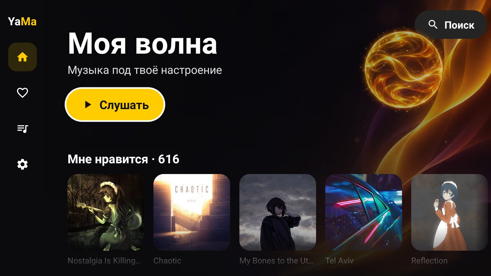
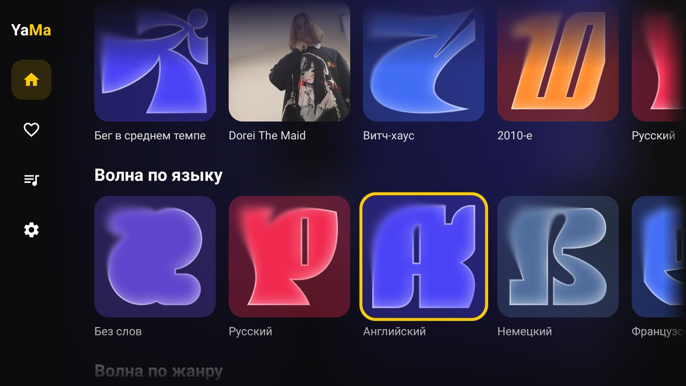
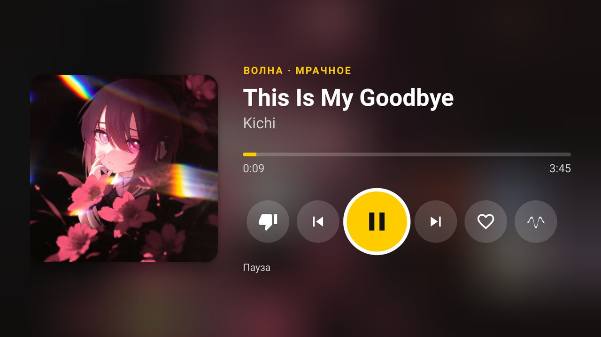
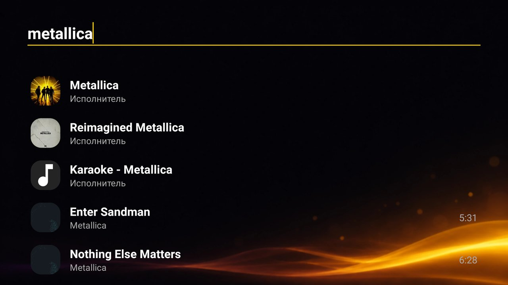

# YaMa — Яндекс Музыка для Android TV

Лёгкий неофициальный клиент Яндекс Музыки для телевизоров на Android TV. Сделан для слабых теликов: на старом 2 ГБ Android 11 работает быстро, APK весит около 2 МБ.



| Волны | Плеер | Поиск |
|---|---|---|
|  |  |  |

## Что умеет

- Вход по QR-коду: сканируешь телефоном и подтверждаешь в Яндексе. Пароль на телике вводить не нужно.
- «Моя волна» и персональные волны, как в официальном приложении: по жанру (вплоть до витч-хауса и синтвейва), по настроению, под занятие, по эпохе, по языку, по исполнителю и по треку.
- «Мне нравится», свои и сохранённые плейлисты.
- Поиск по трекам, исполнителям, альбомам и плейлистам. Есть страница исполнителя с его волной.
- Плеер на весь экран: лайк, дизлайк в волне, волна по текущему треку. Пока играет музыка, экран не гаснет.
- Музыка продолжает играть в фоне и управляется пультом и кнопками медиа.
- Качество на выбор: AAC, MP3 320 или FLAC (lossless).
- Тёмная тема, обложка подкрашивает фон, шар на главной пульсирует в такт музыке.

Нужна подписка Яндекс Плюс.

## Установка

1. Скачай `YaMa-*.apk` со страницы [Releases](../../releases).
2. Поставь на телик любым способом: флешка и файловый менеджер, «Send files to TV» или `adb install YaMa-*.apk`.
3. Открой YaMa и отсканируй QR-код телефоном.

Требования: Android 9 и выше, процессор ARM (armeabi-v7a, на arm64 тоже работает).

## Ограничения

- Это неофициальный клиент на неофициальном API Яндекса. Если Яндекс что-то поменяет, приложение может сломаться до обновления.
- «Слушать на…» (Ynison) не поддерживается: с октября 2026 Яндекс закрыл его для сторонних клиентов.
- Ряд «Мне нравится» на главной играет первые 30 треков. Полный список открывается кнопкой «Все треки».

## Сборка

JDK 17 и Android SDK, дальше:

```bash
./gradlew assembleRelease
```

Без своего ключа релиз подписывается отладочным. Чтобы подписать своим, пропиши `YAMA_KEYSTORE` и `YAMA_KEYSTORE_PASSWORD` в `~/.gradle/gradle.properties`, алиас ключа `yama`.

Kotlin, обычные View без AppCompat, Media3 (ExoPlayer) для звука. Как устроено API, подсмотрено в [MarshalX/yandex-music-api](https://github.com/MarshalX/yandex-music-api).

## Дисклеймер

Проект не связан с Яндексом. «Яндекс Музыка» — товарный знак ООО «Яндекс». Приложение не обходит подписку: всё слушается под твоим аккаунтом с Плюсом.
